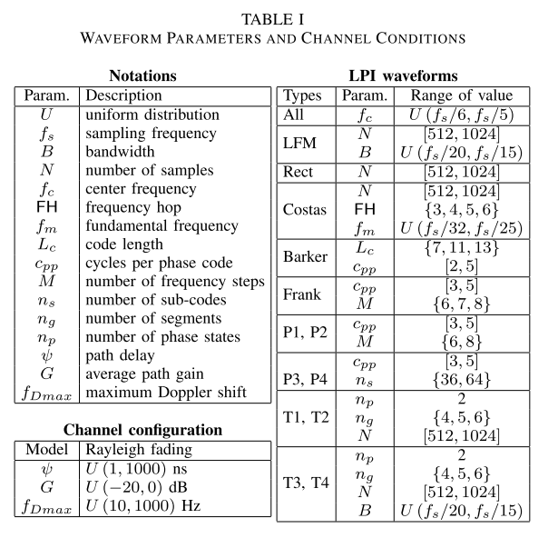
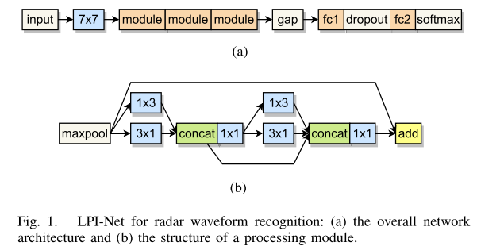
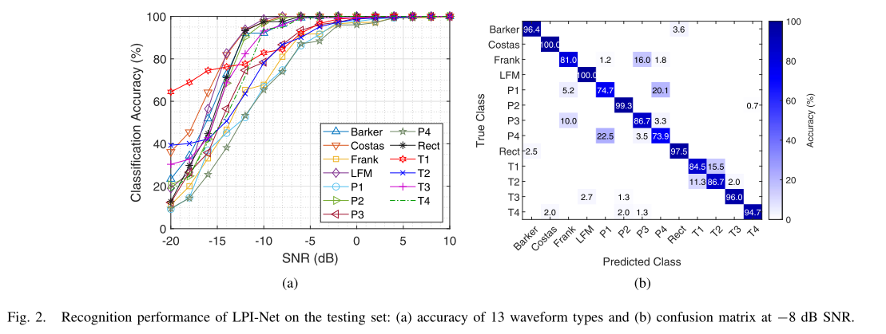
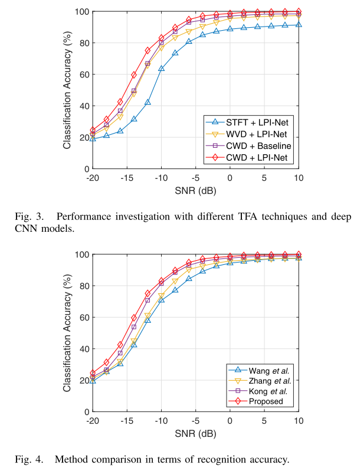

# 13 types of LPI signal identification - CWD-TFA low-intercept probability radar waveform identification based on deep convolutional networks with MATLAB code included.

Introduction: Due to the severe occupation of radio spectrum, automotive radar sensor systems urgently require anti-interference technology, which is typically deployed in electronic warfare systems. A fundamental strategy involves utilizing low-probability interception radar waveforms, where the low-probability characteristic is expected to keep radar signals away from interception receivers typically placed next to radar warning receivers, thereby potentially identifying the transmitter and detecting threats. Therefore, it necessitates the implementation of automatic waveform recognition in advanced interception receivers to reliably authenticate LPI (Low Probability Interference) signals. Existing methods for low-probability radar waveform recognition primarily involve two processes: feature extraction and waveform classification. These involve computing several handcrafted features to describe the characteristics of a one-dimensional raw waveform, such as the higher moments and cumulants of the complex envelope [2], autocorrelation function [3], power spectral density [4], and instantaneous phase and frequency descriptions of descriptive statistics (e.g., variance and kurtosis) [5]. Additionally, some time-frequency analysis (TFA) techniques, such as short-time Fourier transform (STFT) [6], fractional Fourier transform [7], Wigner-Ville distribution (WVD) [8], and Choi-Williams distribution (CWD) [9], are commonly used to simultaneously describe signal characteristics in both the time domain and frequency domain. Advanced combinations of multiple transformations [10] have been introduced to improve waveform recognition accuracy by extracting more relevant features from non-simultaneous time-frequency representations.
Recently, innovative DL architectures have been utilized to achieve an end-to-end process for automatic feature extraction and effective learning of classifiers. To estimate radar waveforms in passive systems, a cascading autoencoder architecture with multiple recurrent neural network structures has been proposed [11] to learn waveform patterns from transmitted signals in an unsupervised manner. Furthermore, CNNs have been widely adopted for identifying the above-mentioned TFA techniques based on radar waveforms as the basis for TFI. Notably, considering that CNNs capture multi-level features and analyze multi-scale representation information of high-dimensional non-structured data (e.g., images and videos), numerous CNN-based LPI waveform recognition frameworks have been introduced. For example, Wang et al. [8] designed a CNN architecture with four convolutional layers to learn visual features of WVDTFI. The deep model was more accurate in recognizing five types of waveforms than the ACF-based method [3]. Kong et al. [12] deployed a simple yet direct CNN architecture to learn visual features of CWD-TFI for 12 waveform classification. In addition to weakly discriminative features extracted by two convolutional layers, due to many trainable parameters in the fully connected layer without global pooling, the network had extremely high computational complexity. Most existing works have two disadvantages: (i) traditional methods extract handcrafted low-level features to learn, which cannot achieve high recognition rates with traditional classifiers, and (ii) deep learning frameworks with conventional CNN architectures hinder the dense utilization of inherent waveform characteristics.
To address the above issues, we propose an effective DL-based method for automatically recognizing various LPI radar waveforms. Specifically, we utilize CWD to analyze the time-frequency representation of radar signals. Compared to STFT and WVD, CWD provides higher time-frequency resolution and interference suppression [13]. The TFI produced by CWD-TFA is learned by a deep CNN (i.e., LPI-Net), which aims to effectively extract highly meaningful features for pattern recognition. In summary, the main contributions can be summarized as follows:
· A high-precision LPI radar waveform recognition method based on an effective DL model and CWD-TFA is proposed.
· Proposes LPI-Net, a deep CNN with multiple cascaded processing modules for learning highly discriminative features in multi-scale representations, where feature collection is associated with skip connections to enrich feature diversity and prevent vanishing gradients.
·Achieve high recognition accuracy of 13 LPI radar waveforms under synthetic channel damage, which is significantly better than other existing TFA technologies and deep models.
Article illustrations
\n        \n      \n        \n      \n        \n  
In this letter, we propose a DL-based approach that significantly enhances the performance of LPI radar waveform recognition. We introduce an advanced CNN model, LPI-Net, to capture relevant features from CWD-TFI. Several core processing modules within LPI-Net are specialized through deep connections with the preceding feature sets and skip connections added elementally to improve learning efficiency. The proposed network achieves a high waveform recognition accuracy of 98.6% under 0 dB SNR, significantly surpassing several state-of-the-art deep networks. Future work will focus on researching some complex TFA techniques (time-frequency rate representation based on fuzzy functions and time coded rate representation [18]) to suppress cross-term interference, and upgrading the network architecture to further enhance waveform recognition accuracy.

## Images

<!-- PAYMENT_BLOCK -->

## Get this dataset

- Payment link (Stripe): [Buy now](https://buy.stripe.com/3cs8yP7sY87d0vu9AB)
- Payment QR code: 

<!-- /PAYMENT_BLOCK -->
